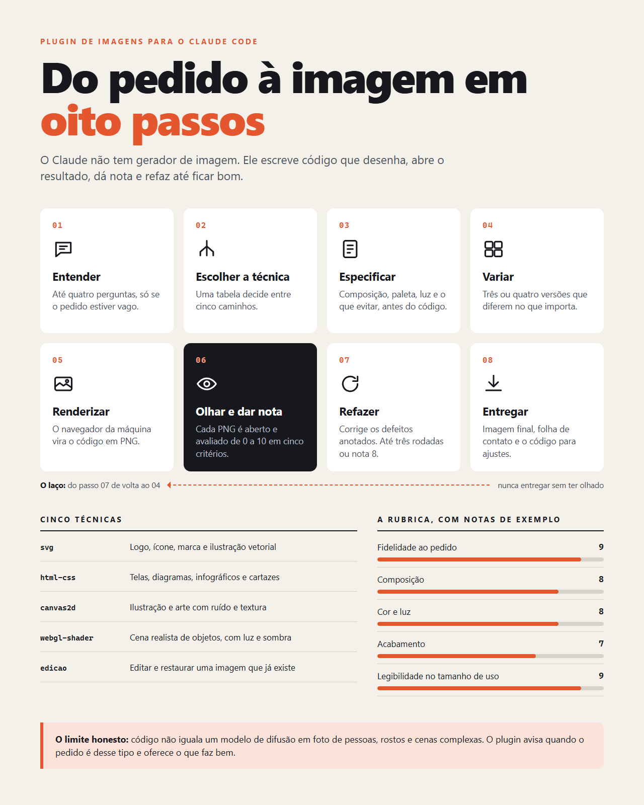
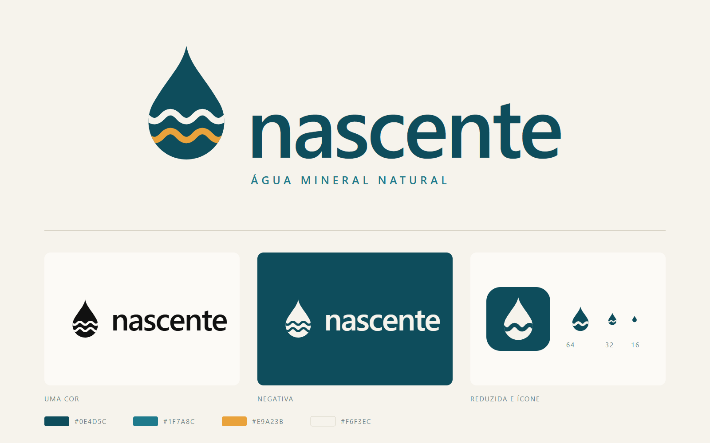
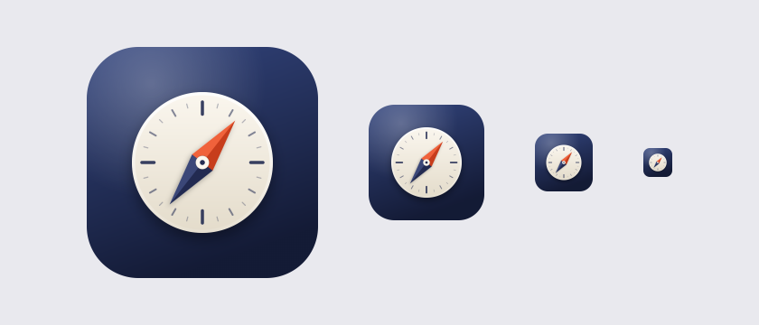
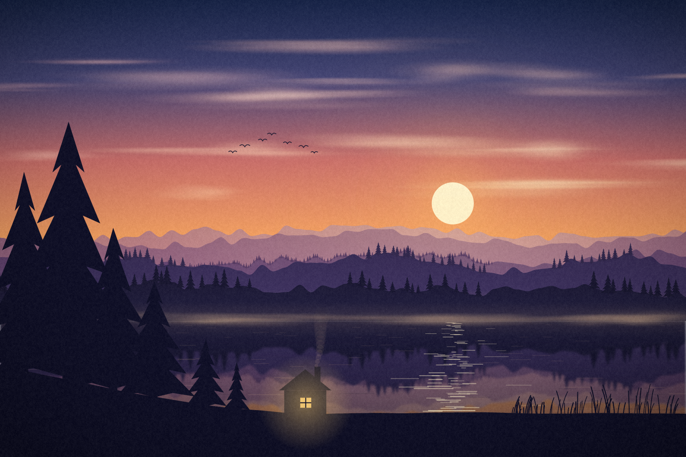
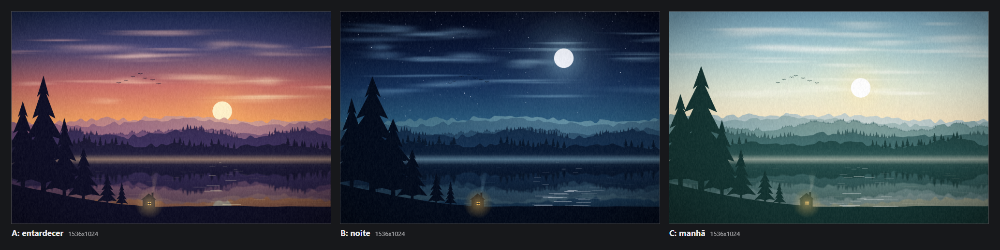
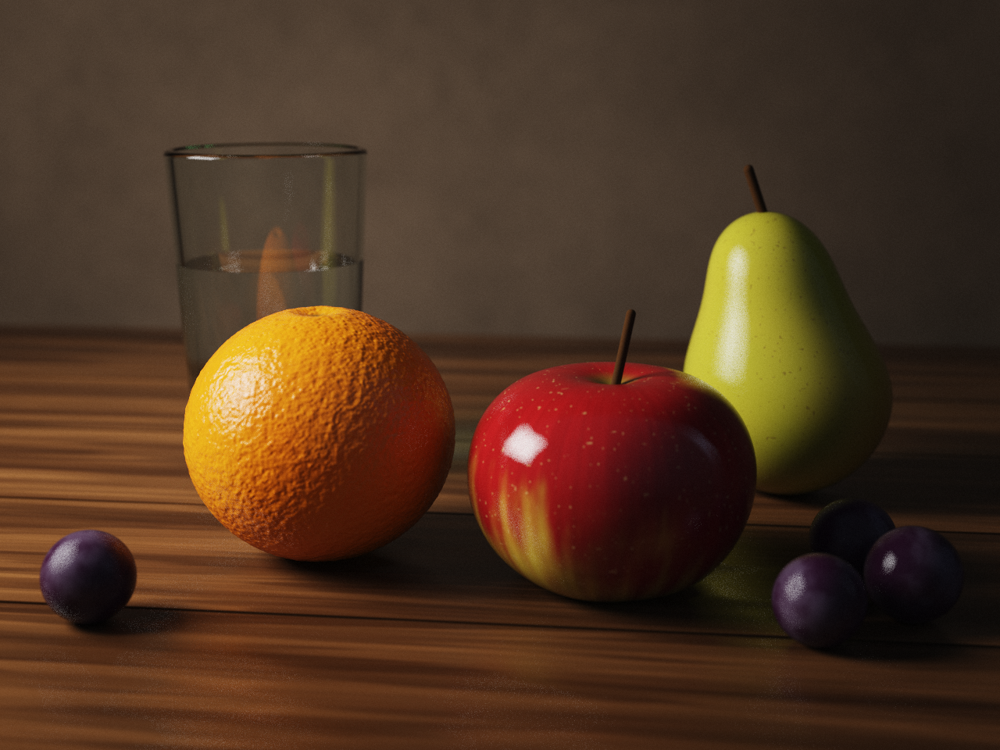
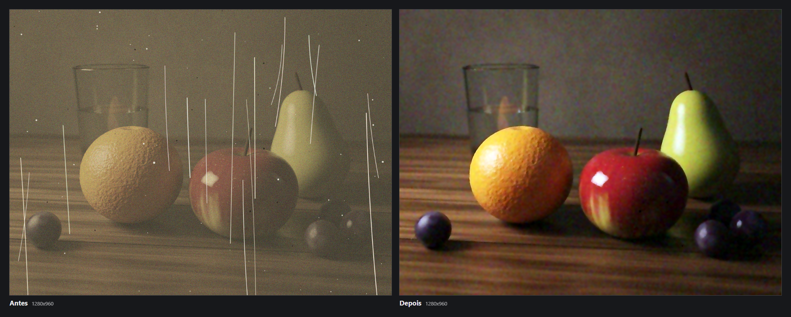
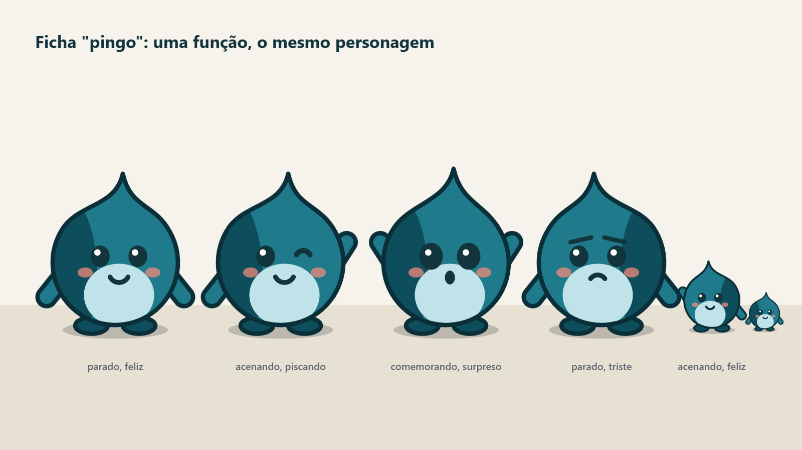

# plugin-imagens-claude-code

Plugin do Claude Code que faz o Claude ficar bom em gerar imagens **sem gerador externo**. Nada de API de
imagem, Canva ou Blender: o Claude escreve código que desenha, renderiza no navegador que já está na sua
máquina, **abre o resultado, dá nota e refaz** até ficar bom.



## O limite honesto

Código não iguala um modelo de difusão em **fotorrealismo de pessoas, rostos, animais e cenas complexas**.
Se você pedir a foto de uma pessoa na rua, o plugin vai dizer isso e oferecer o que faz bem:

- cena renderizada de objetos e ambientes simples (produto, natureza-morta);
- realismo estilizado e ilustração;
- logo, ícone, marca, telas, diagramas e infográficos, onde código costuma ganhar de difusão em precisão e em texto correto;
- edição e restauração de uma imagem que já existe, dentro do que dá para fazer com operações em pixels.

O que sai do caminho "foto realista" é um **render**. De perto, parece render.

## Instalar

```
/plugin marketplace add marco3079/plugin-imagens-claude-code
/plugin install imagens@plugin-imagens-claude-code
```

Para testar a partir de uma cópia local do repositório, troque a primeira linha pelo caminho da pasta:

```
/plugin marketplace add /caminho/para/plugin-imagens-claude-code
/plugin install imagens@plugin-imagens-claude-code
```

### Requisitos

- **Node 18 ou mais novo.** Os scripts não têm dependências: nada de `npm install`.
- **Microsoft Edge, Google Chrome ou Chromium** instalado. No Windows o Edge já vem. O navegador roda sem janela.
- Para o caminho de cena realista, uma placa de vídeo ajuda muito. Sem placa funciona, bem mais devagar.

Se o navegador estiver num lugar fora do padrão, defina `IMAGENS_NAVEGADOR` com o caminho do executável.
Para conferir o ambiente:

```bash
node scripts/renderizar.mjs --diagnostico
```

## Usar

Peça uma imagem em conversa normal ("desenha um logo para a minha padaria", "faz um infográfico sobre X",
"restaura esta foto") e a skill entra sozinha. Ou use os comandos:

| Comando | O que faz |
|---|---|
| `/imagem <pedido>` | Roda o fluxo completo para o pedido |
| `/imagem-editar <arquivo> <o que fazer>` | Edita ou restaura uma imagem, preservando o original |
| `/imagem-estilo [listar, mostrar, salvar]` | Lista, mostra e salva estilos |
| `/imagem-ficha [listar, criar, usar]` | Cria ou usa uma ficha de personagem ou de marca |

As imagens saem em `imagens/<nome-curto>/` no seu projeto: o arquivo final, a folha de contato com as
variações e o código-fonte, para você pedir ajustes ("deixa o céu mais roxo") sem começar do zero.

## Como funciona

1. **Entender.** Se o pedido estiver vago, até quatro perguntas: assunto, uso e tamanho, estilo, o que não pode ter.
2. **Escolher a técnica** entre cinco (tabela abaixo).
3. **Especificar** antes de programar: composição, ponto focal, paleta com hex, luz, materiais, tipografia, o que evitar.
4. **Variar.** Três ou quatro versões que diferem em composição, paleta ou luz.
5. **Renderizar** e montar a folha de contato.
6. **Olhar e dar nota** de 0 a 10 em cinco critérios: fidelidade ao pedido, composição, cor e luz, acabamento, legibilidade no tamanho de uso. Cada nota baixa vem com o defeito escrito em termos corrigíveis.
7. **Refazer** atacando os defeitos, até nota 8 ou três rodadas. A partir da segunda rodada, um subagente crítico que não vê o código avalia as imagens.
8. **Entregar**, dizendo o que ficou fraco.

| Técnica | Para quê |
|---|---|
| `svg` | Logo, ícone, marca, ilustração vetorial |
| `html-css` | Telas, diagramas, infográficos, cartazes com tipografia |
| `canvas2d` | Ilustração e arte procedural, com ruído, textura e semente fixa |
| `webgl-shader` | Cena realista de objetos por path tracing num fragment shader |
| `edicao` | Editar e restaurar uma imagem existente por operações em pixels |

## Exemplos

Todos feitos com o próprio plugin, seguindo o fluxo. As notas são a **menor** das cinco da rubrica. A
coluna do crítico é a nota que um subagente independente deu à versão anterior de cada imagem. As
correções que ele apontou foram aplicadas e as imagens abaixo já são as corrigidas.

| Exemplo | Técnica | Rodadas | Nota do crítico (antes da última correção) | Fonte |
|---|---|---:|---:|---|
| Logo "nascente" | `svg` | 3 | 7 | [`exemplos/logo/`](exemplos/logo/) |
| Ícone de bússola | `svg` | 1 | 8 | [`exemplos/icone/`](exemplos/icone/) |
| Infográfico | `html-css` | 3 | 7 | [`exemplos/infografico/`](exemplos/infografico/) |
| Lago ao entardecer | `canvas2d` | 3 | 7 | [`exemplos/ilustracao/`](exemplos/ilustracao/) |
| Natureza-morta | `webgl-shader` | 5 | 6 | [`exemplos/natureza-morta/`](exemplos/natureza-morta/) |
| Foto restaurada | `edicao` | 5 | 5 | [`exemplos/restauracao/`](exemplos/restauracao/) |

### Logo e ícone



 

### Ilustração



Folha de contato das três variações de paleta da primeira rodada:



### Cena realista (render)



Path tracing de superfícies descritas por funções de distância, com luz de área, sombra suave, vidro com
água, profundidade de campo, ACES e grão, tudo num shader de uma página HTML. É um render e parece um
render: o copo é simples, a madeira é borrada e a pera tem brilho de plástico.

### Foto restaurada



A foto danificada foi fabricada de propósito a partir do render acima (desbotada, amarelada, com ruído,
16 riscos e 90 pontos de poeira) e restaurada por código. Contra o original, o PSNR foi de 14,7 dB para
24,7 dB. Riscos, poeira e a dominante amarela saíram. A textura fina não voltou, e a imagem ficou com um
ar de pintura: tirar ruído forte leva o detalhe junto.

## Estilos

Doze estilos prontos em [`estilos/`](estilos/), cada um com paleta em hex, luz, textura, traço, regras de
composição e um trecho de código: vetor plano moderno, isométrico, aquarela, tinta e papel, retrô anos 60,
cartaz minimalista suíço, neon noturno, render de produto em estúdio, blueprint técnico, pixel art, recorte
de papel em camadas e gravura em linha.

Os seus estilos ficam em `.claude/imagens/estilos/` no seu projeto e **têm prioridade** sobre os do plugin.
Quando gostar de uma imagem, peça "salva esse estilo" ou use `/imagem-estilo salvar <nome>`.

## Fichas de consistência

Para o mesmo personagem ou a mesma marca reaparecer **igual** em várias imagens, a figura vira uma função
de código com parâmetros (pose, expressão, tamanho) mais uma ficha com paleta, proporções e regras. Como é
código, sai idêntica toda vez. As fichas ficam em `.claude/imagens/fichas/` no seu projeto.



O exemplo completo (ficha, módulo e página de demonstração) está em
[`modelos/ficha-exemplo/`](modelos/ficha-exemplo/). Funciona para figura estilizada com um conjunto fechado
de poses, não para personagem em pose livre vista de qualquer ângulo.

## Scripts

Node, sem dependências. Todos aceitam `--ajuda`, imprimem uma linha JSON e saem com código diferente de 0 em erro.

```bash
node scripts/renderizar.mjs pagina.html saida.png --largura 1280 --altura 960   # .html ou .svg para PNG
node scripts/folha-de-contato.mjs folha.png a.png b.png c.png                   # folha rotulada
node scripts/antes-depois.mjs antes.png depois.png lado-a-lado.png              # duas imagens lado a lado
node scripts/info.mjs saida.png --espera 1280x960                               # confere o tamanho
```

O renderizador controla o navegador pelo protocolo DevTools sobre pipe, espera a página avisar que
terminou (`window.IMAGEM_PRONTA = true`), devolve os erros de JavaScript e de shader no JSON e confere
que o PNG saiu com o tamanho pedido. Opções: `--escala`, `--transparente`, `--canvas`, `--seletor`,
`--limite`, `--gpu`.

## Estrutura

```
.claude-plugin/     plugin.json e marketplace.json
skills/gerar-imagem SKILL.md (o fluxo) e referencias/ (um guia por técnica, rubrica, composição, estilos, fichas)
agents/             critico-de-imagem.md
commands/           imagem, imagem-editar, imagem-estilo, imagem-ficha
scripts/            renderizar, folha-de-contato, antes-depois, info
modelos/            um ponto de partida funcional por técnica, e a ficha de exemplo
estilos/            a biblioteca de estilos
exemplos/           as imagens desta página, com o código que gerou cada uma
```

## Licença

MIT. Veja [LICENSE](LICENSE).
